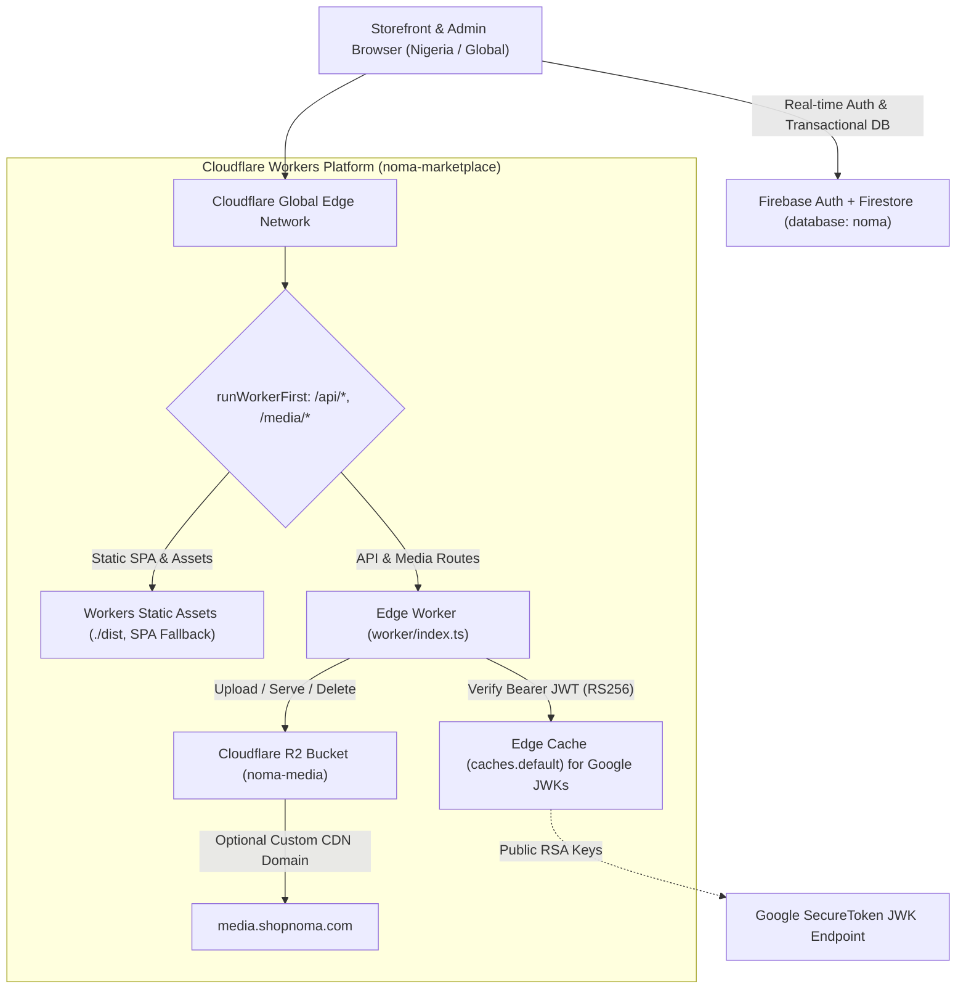

# Noma Marketplace — Cloudflare Hybrid Edge & R2 Architecture Plan

## 1. System Architecture Overview

Noma runs a **Hybrid Edge Architecture** combining **Cloudflare Workers + Workers Static Assets + Cloudflare R2** with **Firebase Auth & Cloud Firestore** (named database `noma`).



### Design Responsibilities
- **Workers Static Assets (`env.ASSETS`)**: Serves the compiled Vite React 19 SPA (`./dist`) globally with zero-egress edge caching, SPA fallback (`notFoundHandling: "single-page-application"`), and static security/cache headers via `public/_headers`.
- **Edge API Worker (`worker/index.ts`)**: Runs first for `/api/*` and `/media/*`:
  - `GET /api/health` — Liveness check + R2 binding verification.
  - `GET /api/delivery-estimate?state=<state>&bulky=<bool>` — Deterministic Nigerian zone delivery estimator (`Lagos`, `Ogun`/`Oyo`, `FCT - Abuja`/`Rivers`, and nationwide interstate, plus `+₦4,000` bulky surcharge and express tier).
  - `POST /api/media/upload` — Validates Firebase Auth Bearer JWT via Web Crypto RS256 against Google's `securetoken@system.gserviceaccount.com` JWKs (cached in `caches.default`), enforces `image/jpeg|png|webp|avif` and `<= 10 MB`, streams `file.stream()` through `FixedLengthStream` into `env.NOMA_MEDIA`, and returns `201 { url, key }`.
  - `DELETE /api/media/*` — Verifies Bearer JWT and removes object keys from `env.NOMA_MEDIA`.
  - `GET /media/*` & `HEAD /media/*` — Streams cached media objects from R2 with `ETag`, conditional `304 Not Modified`, and `Cache-Control: public, max-age=31536000, immutable`.
- **Cloudflare R2 (`NOMA_MEDIA`)**: Primary product, category, supplier, and banner media storage with zero egress fees.
- **Firebase Auth & Cloud Firestore (`noma`)**: Continues to power real-time product catalog subscriptions, customer/admin profiles, order persistence (`orders/{orderId}`), and reviews under hardened security rules (`firestore.rules`).

---

## 2. Configuration & Schema Verification (`cf` CLI)

Noma's deployment config lives in `cloudflare.config.ts` and targets the official **`cf` CLI** (`cf@1.0.0-rc.2` / `@cloudflare/config@1.0.0-rc.1`).

Key schema notes verified against `@cloudflare/config@1.0.0-rc.1`:
- `worker.assets` accepts `{ notFoundHandling, htmlHandling, basePath, runWorkerFirst }` (strict Zod schema — no `directory` key inside `worker.assets`).
- `env.ASSETS` is attached explicitly via `bindings.assets()`.
- `env.NOMA_MEDIA` is attached via `bindings.r2({ name: 'noma-media' })`.
- `observability` enables both Workers Logs (`persist: true`, `headSamplingRate: 1`) and Traces (`enabled: true`, `headSamplingRate: 0.1`, `persist: true`).

### Required Vite Build Integration (Before First `cf build` / `cf deploy`)
Because `vite.config.ts` is owned by the frontend/build pipeline, add `@cloudflare/vite-plugin` (`>= 2.0.0-rc.0`) to `package.json` and `vite.config.ts` prior to running `cf dev` / `cf deploy`:
```ts
// vite.config.ts (Wave 2/3 or Release Integration)
import { cloudflare } from '@cloudflare/vite-plugin'
// plugins: [react(), cloudflare(), VitePWA(...)]
```

---

## 3. Step-by-Step Deployment & R2 Provisioning Runbook

### Prerequisites
1. Install Node.js `>= 22.18` (verified local runtime: `v24.18.1`).
2. Install the Cloudflare CLI globally:
   ```bash
   npm install --global cf
   cf --version
   ```

### Step 1: Authenticate with Cloudflare
```bash
cf auth login
cf auth whoami
```
*(In CI/CD or headless environments, export `CLOUDFLARE_API_TOKEN` instead of interactive OAuth.)*

### Step 2: Provision the R2 Media Bucket & Custom CDN Domain
```bash
# Create the production R2 bucket (West Europe / Western-North Africa lowest RTT)
cf r2 buckets create --name noma-media --location-hint weur

# Preview / verify bucket creation
cf r2 buckets list
```

Configure CORS on `noma-media` so browser uploads or custom domain fetches work cleanly:
```bash
cf r2 buckets cors update noma-media --rules '[
  {
    "allowed": {
      "origins": ["https://shopnoma.com", "https://www.shopnoma.com", "http://localhost:5173"],
      "methods": ["GET", "HEAD"],
      "headers": ["Content-Type", "If-None-Match"]
    },
    "exposeHeaders": ["ETag"],
    "maxAgeSeconds": 86400
  }
]'
```

Attach the dedicated custom media CDN domain (`media.shopnoma.com`):
```bash
cf r2 buckets domains custom create noma-media \
  --domain media.shopnoma.com \
  --zone-id <YOUR_CLOUDFLARE_ZONE_ID> \
  --enabled true \
  --min-tls 1.2
```
Once enabled, update `R2_PUBLIC_URL` in `cloudflare.config.ts` (or in Admin Settings -> `cloudflarePublicUrl`) to `https://media.shopnoma.com`.

### Step 3: Build, Typecheck & Deploy via `cf`
```bash
cd noma

# Verify both frontend & Worker TypeScript builds
npx tsc --noEmit
npx tsc -p tsconfig.worker.json --noEmit

# Local development against Workers runtime + local Miniflare R2 simulation
cf dev

# Production build & deploy
cf build
cf deploy
```

### Step 4: Secrets & Live Diagnostics (`cf-cli` Supported Fallback Commands)
Per the `cf-cli` specification, use `npx wrangler` without adding a Wrangler config file for the two commands `cf` does not yet handle natively:
- **Set a single secret** (e.g., future Paystack / Turnstile secret):
  ```bash
  npx wrangler secret put TURNSTILE_SECRET_KEY --name noma-marketplace
  ```
- **Or batch-upload secrets during versioned deploy**:
  ```bash
  cf deploy --secrets-file .env.secrets
  ```
- **Stream live Worker logs**:
  ```bash
  npx wrangler tail noma-marketplace
  ```

---

## 4. Security Hardening Roadmap (Firebase + Edge + Turnstile)

### A. Firebase Firestore & Storage Rules (Implemented Now)
- Deploy hardened rules targeting the named Firestore database `noma`:
  ```bash
  firebase deploy --only firestore:rules,storage
  ```
- **Current Bootstrap Caveat (`users/{userId}`)**:
  `firestore.rules` allows creating `users/{uid}` when `!exists(/databases/$(database)/documents/users/$(userId))` so initial admin onboarding works. Immediately after provisioning production operators:
  1. Tighten `allow create` on `users/{userId}` to `request.resource.data.role == 'customer'`.
  2. Disable or gate `/admin/register` behind an invitation token or Firebase Admin SDK script.
- **Worker Auth Hardening (Next Step)**:
  Currently `POST /api/media/upload` and `DELETE /api/media/*` validate any non-anonymous Firebase Auth ID token via RS256. Next step: stamp Firebase Custom Claim `{ admin: true }` via Admin SDK when promoting operators, and assert `payload.admin === true` in `worker/index.ts`.

### B. Cloudflare Turnstile Bot Protection
Protect `/checkout`, `/api/media/upload`, and customer registration against automated card-testing and spam:
1. Create a Turnstile widget in Cloudflare (`cf turnstile ...` or Cloudflare Dashboard) and add `VITE_TURNSTILE_SITE_KEY` to frontend build env.
2. Store `TURNSTILE_SECRET_KEY` via `npx wrangler secret put TURNSTILE_SECRET_KEY --name noma-marketplace`.
3. Add a `POST /api/verify-turnstile` (or verify `cf-turnstile-response` token in `POST /api/orders`) calling `https://challenges.cloudflare.com/turnstile/v0/siteverify` before committing high-risk checkout or review writes.

### C. Paystack Webhook & Server-Side Order Verification
Move Paystack transaction verification (`GET https://api.paystack.co/transaction/verify/:reference`) and webhook HMAC-SHA512 (`x-paystack-signature`) validation into `worker/index.ts` using `PAYSTACK_SECRET_KEY` (stored as a Worker secret) and `crypto.subtle.timingSafeEqual()`, so order totals and `status: 'placed'` cannot be spoofed client-side.

---

## 5. Phase 2 Blueprint — Full-Cloudflare Migration (D1 + Queues + Workflows)

When transaction volume or multi-region analytics outgrow client-side Firestore queries, migrate transactional commerce cleanly into Cloudflare-native primitives:

| Layer | Phase 1 (Current Hybrid) | Phase 2 (Full Cloudflare Edge) |
| --- | --- | --- |
| **SPA & Assets** | Workers Static Assets (`./dist`) | Workers Static Assets (`./dist`) |
| **Media CDN** | Cloudflare R2 (`noma-media`) | Cloudflare R2 + Cloudflare Images transforms |
| **Primary Database** | Cloud Firestore (`noma`) | **Cloudflare D1** (SQLite at the edge: `products`, `categories`, `suppliers`, `orders`, `order_items`) |
| **Async Webhooks / Alerts** | Client-triggered | **Cloudflare Queues** (`noma-order-events`: Paystack reconciliation, WhatsApp / Email alerts, supplier notifications) |
| **Order Fulfillment State Machine** | Admin status updates | **Cloudflare Workflows** (durable multi-step order verification -> supplier payout ledger -> GIG Logistics dispatch tracking -> delivery confirmation) |
| **Admin Sessions & Caching** | Firebase Auth | Firebase Auth / Cloudflare Access + **Workers KV** for edge catalog cache |

### Phase 2 Order Fulfillment Workflow Sketch
1. **Checkout Worker** writes order with `status = 'pending_payment'` into **D1** and returns Paystack checkout session.
2. **Paystack Webhook Worker** verifies HMAC-SHA512 signature, marks order `placed` in **D1**, and enqueues `{ orderId }` onto **Queues (`noma-order-events`)**.
3. **Fulfillment Workflow (`OrderFulfillmentWorkflow`)** runs durable steps:
   - `step.do('decrement-inventory', ...)` — Atomic D1 stock update.
   - `step.do('notify-supplier', ...)` — Sends supplier wholesale PO summary.
   - `step.waitForEvent('dispatched', ...)` — Pauses without compute cost until admin marks package handed to courier.
   - `step.do('send-receipt', ...)` — Triggers customer receipt via Cloudflare Email Service / WhatsApp API.

### Estimated Monthly Infrastructure Cost (Phase 1 vs Phase 2)
*(Estimates based on Cloudflare Workers & R2 standard published free/paid tier allowances for a growing Nigerian SMB storefront — ~50k–250k monthly requests, 10–25 GB product media):*
- **Workers & Static Assets**: Free tier covers 100k Worker requests/day (unlimited static asset requests); **Workers Paid ($5/month base)** covers 10M Worker requests/month + 30M CPU ms, with negligible overage for typical Nigerian e-commerce volume.
- **Cloudflare R2 (`noma-media`)**: Free tier covers 10 GB storage, 1M Class A writes, 10M Class B reads/month, and **$0 egress bandwidth** regardless of image traffic volume. Above 10 GB: ~$0.015/GB-month.
- **Phase 2 D1 + Queues + Workflows**: Included within the **$5/month Workers Paid** plan base allowances (5M D1 rows read/day free; 25B rows read/month on Paid), keeping total Cloudflare edge infrastructure under **$5–$15/month** at early-to-mid marketplace scale while eliminating CDN egress bills.
